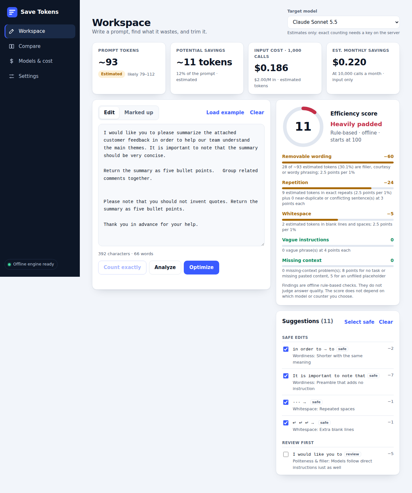
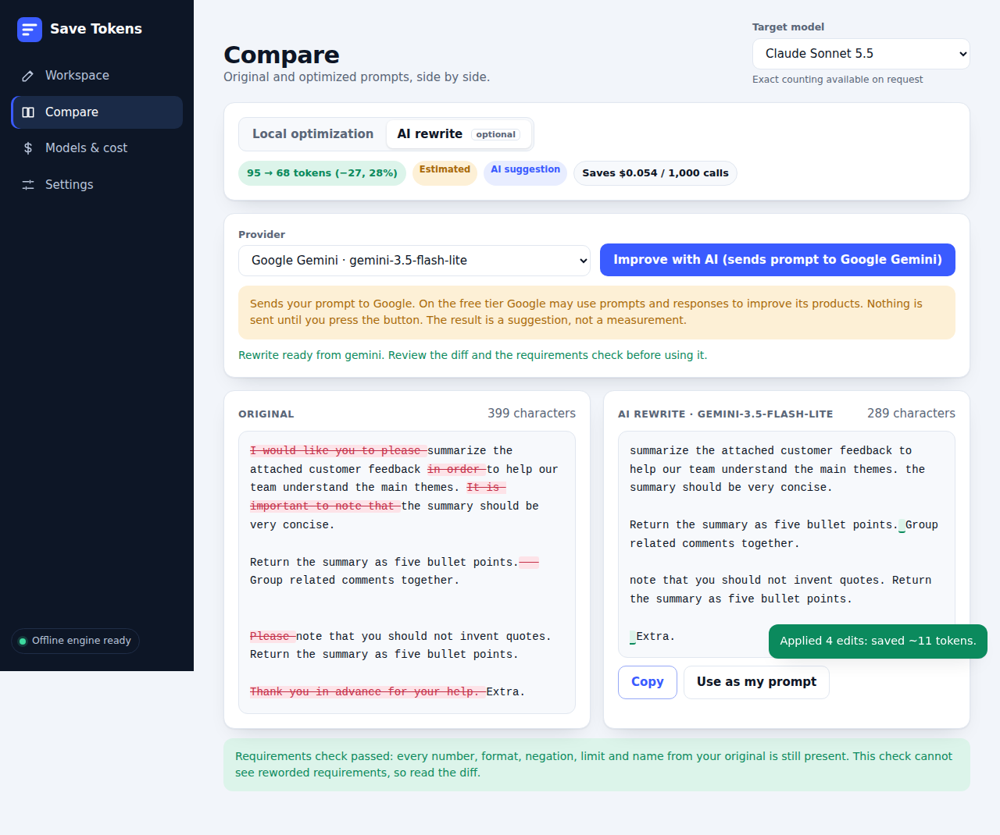
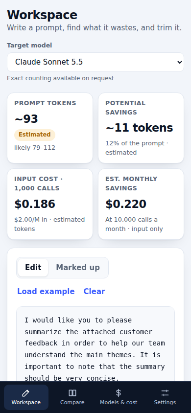

# Save Tokens V4

Find what your prompts waste, see what they cost, and trim them. **Free-first:** everything important works offline with no account and no key. Every external call is optional and happens only when you click a button.

## Run
    npm start        # http://localhost:5173  (set PORT to change)
    npm test         # 162 tests; no network, no keys needed

Requires Node 20+. No dependencies, no build step. Optional extras: `cp .env.example .env` and fill in what you want.

## What you get
- **Workspace:** a large editor with **Analyze**, **Optimize** and **Count exactly** buttons, a target-model selector, an efficiency-score ring with a per-criterion breakdown, token / savings / cost cards, and suggestions you can tick on and off. A *Marked up* tab underlines every finding in your text.
- **Compare:** original vs optimized with a word-level diff, token and cost deltas, and a requirements check. Tabs for **local optimization** and the optional **AI rewrite**.
- **Models & cost:** editable per-model prices and a scenario table (calls per month, expected output tokens).
- **Settings:** which providers are on, exactly what each one does with your prompt, and light / dark / auto theme.
- Responsive: sidebar on desktop, icon rail on tablet, bottom tab bar on phones. Loading skeletons, empty states and error messages throughout.

| | |
|---|---|
|  |  |

## Free-first architecture
| Capability | Needs | Runs | Label in the UI |
|---|---|---|---|
| Analysis, efficiency score, local optimization, diff, cost estimates | nothing | your browser | score is rule-based; tokens **Estimated** |
| Exact token counts for Claude models | `ANTHROPIC_API_KEY` | Anthropic, via your server, **on click** | **Measured · Anthropic** |
| Exact counts for the OpenAI o200k encoding | `npm install gpt-tokenizer` (optional) | your machine, no network | **Measured · local tokenizer** |
| AI rewrite (Gemini, free tier) | `GEMINI_API_KEY` | Google, via your server, **on click** | **AI suggestion**, always estimated |
| AI rewrite (Ollama) | Ollama running locally + `OLLAMA_MODEL` | your machine | **AI suggestion** |
| AI rewrite (Hugging Face) | `HF_TOKEN` + `HF_MODEL` | Hugging Face, via your server, **on click** | **AI suggestion** |

No paid API is required for anything. API keys live in the server process only: they are never sent to the browser, returned by any route, written to logs, or included in error messages (tests spawn the real server and check this, including when a provider echoes the key back).

## Models, providers and pricing
Pick a **provider**, then a **model**, then a **reasoning effort** when the model has one. Everything comes from one registry (`public/models.js`): Claude (Sonnet / Opus / Haiku / Fable), Gemini 3.5 Flash-Lite, **Google Antigravity** (Gemini at Low / Medium / High), **OpenAI Codex** (Terra at Low / Medium / High, and Luna), your own custom model, and local tokenizers when installed.
- **Terra and Luna are your labels, not pinned models.** They are real OpenAI tiers, but each exists in more than one generation, so no model id, tokenizer or price is assumed: candidates and their evidence are listed, counts are *fallback estimates*, and no price is shown until you enter one.
- **Pricing has a status:** *Verified* (checked against the provider's page, with source and date: the Claude rates), *Reported* (third-party, unchecked), *Your price*, or *Unavailable* (no figures and no savings are shown). Antigravity is quota-metered, so it has no per-token price.
- **Reasoning effort never changes your prompt's input tokens**; it affects output (reasoning) tokens and quota use.
- Details, evidence and what is and is not verified: [`docs/MODELS.md`](docs/MODELS.md). QA results: [`docs/QA-REPORT-model-intelligence.md`](docs/QA-REPORT-model-intelligence.md).

## Measured vs estimated
Every token number carries a badge. **Estimated** is the offline heuristic (`heuristic-v2`, assumed margin, not benchmarked against a real tokenizer). **Measured** appears only when a real counter answered for that exact text and model; edit one character, switch model, or change which edits are applied and it reverts to **Estimated**. Before/after savings are measured only if *both* texts were measured, never a measured number minus an estimate. A measured Anthropic count is the API's answer for the text as a single user message; Anthropic itself calls it an estimate that can differ slightly from billing, so it is marked `exact: false`. AI rewrites and cost figures are always estimates. Characters, words and bytes are exact facts.

## Optional AI rewriting
Press **Improve with AI** (Compare → AI rewrite). Before you press it the UI shows where the prompt will go and whether the provider may keep or use it.
- **Google Gemini:** `POST …/v1beta/models/{model}:generateContent` with `x-goog-api-key`. Default model `gemini-3.5-flash-lite` (change with `GEMINI_MODEL`). On the free tier Google may use prompts and responses to improve its products, and free-tier quotas change, so quota errors (`429`) are handled and shown with a retry time.
- **Ollama:** `POST {OLLAMA_BASE_URL}/api/chat`. Fully local. The Settings page shows whether Ollama is reachable.
- **Hugging Face:** OpenAI-compatible `POST https://router.huggingface.co/v1/chat/completions` with a bearer token. The free monthly credit is small; `402` is reported as "credits used up".

Safety pipeline: your prompt is sent inside `<prompt_to_rewrite>` tags with a system instruction to treat it as data (prompt-injection hardening); output that was cut off, blocked, empty or not valid JSON is discarded; every rewrite is checked against your original for dropped requirements (numbers, formats, negations, limits, quoted text, names) and a warning plus a "Use anyway" button appear if something is missing. A rewrite is never applied automatically. The check is presence-based and cannot see reworded requirements, so read the diff.

## Local tokenizers
`server/tokenizers.js` loads a tokenizer only if its package is installed (`gpt-tokenizer` for the OpenAI o200k encoding); nothing is a dependency. Extra tokenizers can be passed in as `{ id, label, note, count(text) }`. The count is text-only (no chat framing) and valid only for its own encoding.

## Pricing and cost
Prices are USD per million tokens and are **editable defaults**: Claude 5.5-family rates as summarised in October 2026 (Haiku $0.10/$0.50, Sonnet $2/$10, Opus $4/$20, Fable $10/$50; Haiku's rate applies to prompts up to 100K tokens), Gemini Flash-Lite at the free tier ($0), and no price for unknown models. Check them against your plan; discounts, caching and long-prompt tiers are not modelled. Edits are stored in your browser. Trimming a prompt changes **input** tokens only, so savings exclude output.

## Exact counting for Claude (opt-in)
`POST /v1/messages/count_tokens` with `x-api-key` and `anthropic-version: 2023-06-01`; body `{model, messages:[{role:"user",content}]}`; response `{input_tokens}`. Free, rate-limited. Counts are per model (models from Opus 4.7 onward use a newer tokenizer with roughly 30% more tokens than earlier ones). Default models: `claude-sonnet-5-5`, `claude-opus-5-5`, `claude-haiku-5-5`, `claude-fable-5-1`; IDs the docs list as unsupported (`claude-sonnet-4-5`) or retired (`claude-mythos-preview`) are dropped with a warning. Errors are mapped to clear messages (`auth`, `permission`, `rate_limited`, `model_unavailable`, `too_large`, `blocked` for proxies, `timeout`, `network`, …) and the request-id is shown and logged.

## Efficiency score
Starts at 100 and loses whole points per criterion; the points shown add up exactly to `100 − score`. It never depends on the model or counter chosen.

| Criterion | Loss | Max |
|---|---|---|
| Removable wording (filler, courtesy, wordy phrases) | 2.5 per 1% of estimated tokens | 60 |
| Repetition (exact repeats, near-duplicates, conflicting numbers) | 2.5 per 1%, 3 per near-duplicate | 30 |
| Whitespace | 2.5 per 1% | 10 |
| Vague instructions | 4 each | 20 |
| Missing context (no task, dangling colon, placeholder) | 8 / 8 / 5 | 15 |

## How optimization decides what to remove
Each edit has one of three levels, and **Optimize applies every *recommended* edit by default**:
- **safe**: meaning-preserving by construction (`in order to` → `to`, extra blank lines, a repeat of a non-requirement sentence).
- **recommended**: removing it cannot lose a requirement, but it is not a pure swap: courtesy and emphasis frames (`I want you to`, `please`, `make sure to`, `remember to`, `it is important to note that`), a closing sentence that is *only* thanks, an exact repeat in the same section, and a sentence that is already said in other words (below).
- **review**: can change tone or degree (`very`, `really`, `simply`, `actually`), or repeats a sentence from *another section*. Never applied unless you tick it.

**Repeated instructions in different words.** Sentences are compared by their content words (courtesy and filler ignored, light plural stemming, `give / provide / include / offer` treated as one verb). Within one section:
- a positive instruction is removed when its words and requirement markers (numbers, formats, `exactly`, limits…) are all contained in another sentence, whichever comes first, so `Keep it short.` is dropped in favour of `Keep it short, under 200 words.` and `Make sure to include exactly 3 examples.` in favour of `Give me exactly 3 examples of …`;
- a **negated or limited** sentence (`not`, `never`, `avoid`, `only`, `unless`, `if`, `when`…) is merged only with an identical-content sentence, because a shorter sentence there is the *stronger* rule (`Avoid jargon.` vs `Avoid jargon in titles.`); other overlaps are shown as advice;
- sentences with fewer than three content words are never auto-merged; sentences under different headings are never merged; conflicting numbers (`under 50 words` vs `under 80 words`) are flagged, never merged.

**The same idea in different words (semantic repetition).** "I am a beginner", "easy for beginners to understand" and "beginner-friendly and easy to follow" share no sentence structure, but they all say *who the answer is for / how plain to make it*. A small hand-written, fully offline lexicon recognises talk about **how to write**: audience level (`beginner`, `novice`, `newcomer`, `layperson`, `beginner-friendly`, `new to this`), readability (`simple`, `easy`, `clear`, `plain English`, `straightforward`), length (`short`, `brief`, `concise`) and depth (`detailed`, `thorough`). It never contains topics, examples, numbers or formats.
- A **style span** is a whole sentence made of nothing but style wording, or a trailing clause such as `in a way that is easy for beginners to understand`, `in simple terms`, `for beginners`, `so that … can follow it`. A span containing a topic word, number, format, example, quote or negation/condition (`not`, `only`, `if`, `unless`…) is *not* style-only and is never touched, so `Write simply in 3 bullet points.` and `Use simple language such as cat and dog.` are left alone.
- Within one section, a span is suggested for removal when another span already states **all** of its concepts. Equal concepts (a true paraphrase, e.g. `Keep it short.` / `Keep it concise.`) are **pre-selected**; a partial overlap (`Make it easy to follow.` after a beginner-friendly sentence) and any sentence that says something about *you* (`I am a beginner.`) are **offered but unchecked**. Different audiences (`beginners` vs `experts`), opposite ideas (`short` vs `detailed`) and instructions that merely sound related (`Use simple language`) are never merged.
- These appear as ordinary checkboxes in the suggestion list (kind *Repetition*), are underlined in *Marked up*, and are applied by Optimize like any other edit.
- Safety nets at apply time: each suggestion is re-checked to still be purely style wording, and a style concept can never disappear from the prompt entirely, even if several suggestions that rely on each other are ticked (the offending ones are reverted and reported).

**One source of truth for repetition.** The score, the findings list and the suggestions all read the same repetition findings. The *Repetition* row of the score breaks them down as `repeated sentences + restated ideas (the semantic detector) = tokens of the whole prompt`, plus near-duplicate/conflict advice, and says when the −30 cap hides the effect of fixing only part of it. Opt-in suggestions (for example `I am a beginner.`) count in the score even though they are not pre-selected; applying every repetition finding drives the penalty to 0. `analyze()` exposes the same numbers as `repetition` and `criteria[].parts`.

**Potential vs achieved savings.** These are different things and are never mixed:
- **Potential (estimated, before you change anything).** What the selected edits would save, shown on the *Potential savings* card ("if you apply the selected edits", plus "all suggestions together") and in Compare ("Optimized version … Not applied to your prompt yet", "Would save …"). `analyze().potential` has `{ basis: 'potential', recommended, all }`, each recounted from the would-be text rather than summed from per-edit guesses.
- **Achieved (after you adopt a version).** Pressing **Use as my prompt** remembers your original and recounts *original vs adopted* with `measureSavings()`, the same counter or estimator for both texts; the card then shows "Achieved: … vs your original" and a toast repeats the recount. It is shown only while the editor still holds exactly the adopted text (edit it and it disappears; revert and it returns), chains to your *first* original if you keep optimizing, and resets on Clear and Load example. Optimize on its own only previews: it never changes your prompt and never claims savings.
- Both are labelled estimated or measured by the counter used; a measured count is never subtracted from an estimate (if only one text can be measured, both fall back to the estimator).

**Accurate numbers.** Reported before/after/saved come from running the same counter on the whole original and the whole optimized text (measured only if both were measured), and each edit's saving is measured on the whole text too, so the per-edit numbers add up to the total. An edit that would add tokens is refused. When nothing changes you are told why: `already_lean`, `review_only`, `nothing_selected` or `all_skipped`. `optimizePrompt(text)` in `core.js` runs analyze → apply recommended → repeat until stable (max 3 passes) and reports the end-to-end reduction.

Limits: the concept lexicon is small and English-only, so unlisted wording (`anyone can follow it`, `for people with no background`) is not recognised; style clauses in the *middle* of a sentence are not cut; and word-containment is a heuristic, not understanding. It can miss paraphrases that share few words, and it can only be wrong in the direction of removing a sentence whose words and requirement markers are all present in another one; the requirements check and the diff in Compare are there for you to confirm. Rules are English-only.

## Optimization never silently drops a requirement
Only edits are applied; advice never is. Code, quoted text, URLs, `{{variables}}` and `<tags>` are never edited. Requirement markers (negations, limits, numbers, formats, quoted strings, URLs, identifiers) are tracked; an edit that would lose one is protected or reverted and reported. Edits in sentences that state requirements start unchecked.

## Verification status (read this)
- **Automated (`npm test`, 162 tests, 161 pass, 1 skipped):** analysis engine, pricing and diff maths, server API, provider adapters, error mapping, rate limits, secret-leak checks that spawn the real server, client modules, and static UI contract checks. All use mocked upstreams.
- **Browser:** the UI was exercised in a headless browser against the real server with local stand-ins for Anthropic and Gemini (offline, keyed, failing and dropped-requirement scenarios; three viewport sizes; no horizontal overflow or console errors). Screenshots are in `docs/screenshots/`.
- **Not verified here:** the live Anthropic, Gemini and Hugging Face APIs, a running Ollama, and the `gpt-tokenizer` package (no network or keys were available, and packages cannot be installed offline). Verify with your own configuration:

      npm run verify:live                  # Anthropic counting, per model
      npm run verify:live -- --rewrite     # the AI-rewrite providers you configured
      SAVE_TOKENS_LIVE_TEST=1 npm test     # opt-in live Anthropic test

  Exit code `0` = passed, `1` = a failure, `2` = nothing configured (not a pass). Output never contains keys. A skipped live test means live verification did not happen.

## Security
Binds to `127.0.0.1`; `/api` rejects foreign `Host` (DNS rebinding) and `Origin` headers, requires JSON, caps sizes, rate-limits upstream calls, never logs prompts or keys, and static pages carry a strict Content-Security-Policy (no inline scripts or styles). Preferences live in `localStorage` and are validated on load.

## Layout
`public/` (UI: `app.js`, `core.js` engine, `counting.js`, `rewrite.js`, `models.js`, `diff.js`) · `server/` (`app.js`, `anthropic.js`, `rewrite.js`, `tokenizers.js`, `config.js`, `verify.js`) · `scripts/verify-live.mjs` · `test/`

## Limitations
English-only rules; heuristic token estimates are uncalibrated; prices are defaults you must confirm; Gemini free-tier models and quotas change; local tokenizers cover only what you install; counts cover a single user message (no system prompt, tools or files).

## Next
Calibrate the heuristic against real counts, add Gemini's own token-counting endpoint as another measured route, and add a provider-agnostic "test connection" button in Settings.
